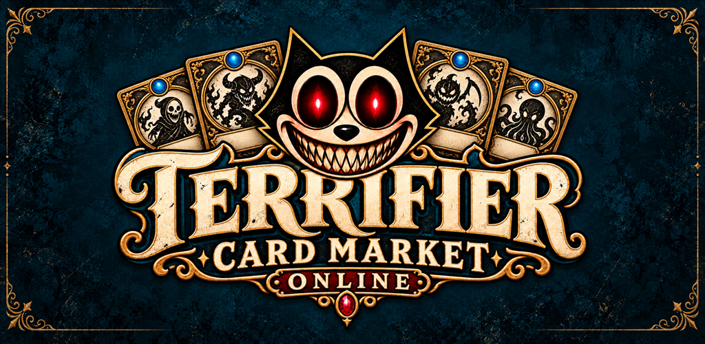
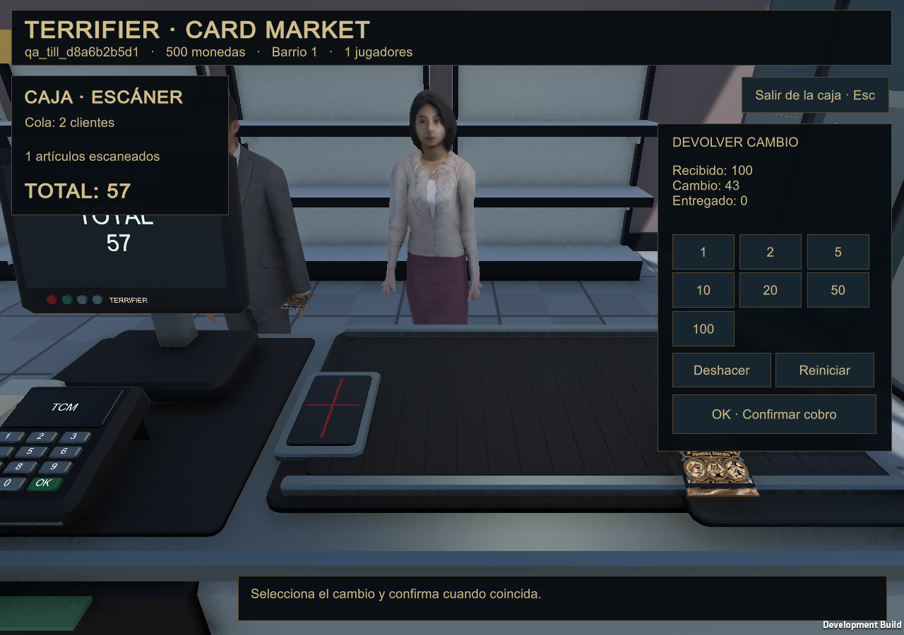
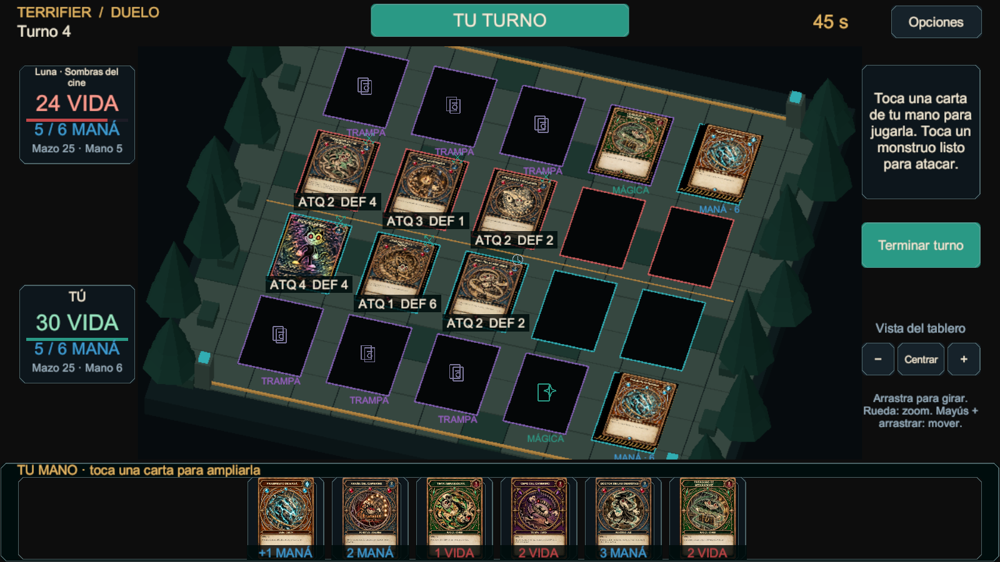
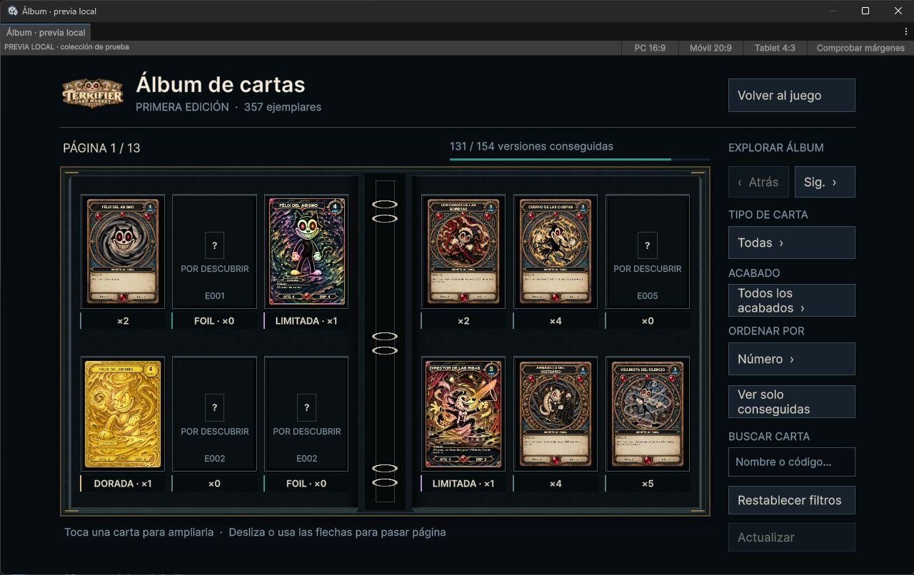
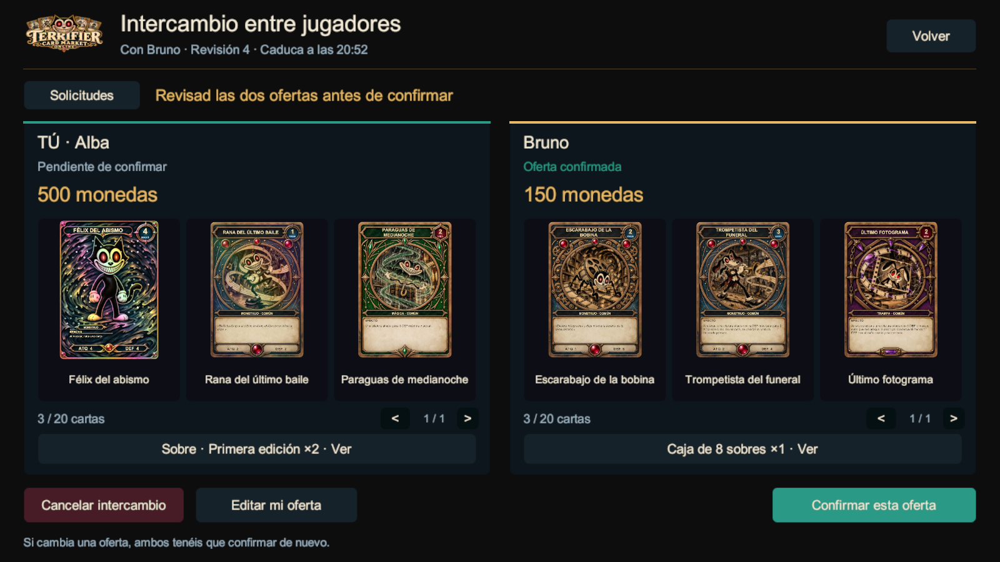
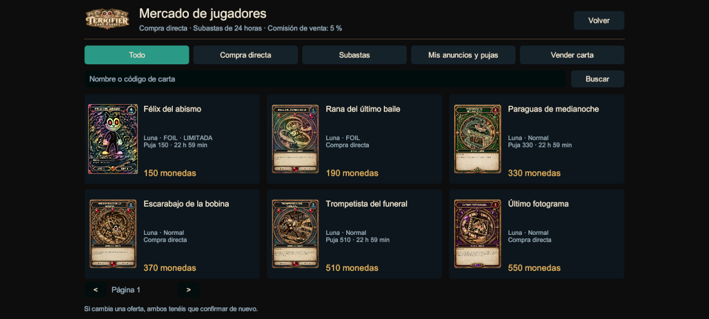

# Terrifier Card Market Online — simulador de tienda de cartas y duelos

**Terrifier Card Market Online es un juego de gestión de una tienda de cartas coleccionables, con duelos y multijugador online.** Abre un negocio lleno de criaturas de dibujos animados de terror: pide cajas, repón estanterías, pon tus precios y atiende a los clientes. Después abre sobres de seis cartas, completa tu álbum y crea un mazo para jugar contra otros jugadores o NPCs.

**Gratis · Windows y Android · En desarrollo · Requiere Internet**

**[Descargar en Google Play](https://play.google.com/store/apps/details?id=com.noxgamestudio.terrifiercardmarket) · [Descargar ZIP para Windows](https://github.com/gorak182/terrifier-card-market-downloads/releases/latest/download/TerrifierCardMarket-Windows.zip)**

[Web en español](https://gorak182.github.io/terrifier-card-market-downloads/es/) · [English website](https://gorak182.github.io/terrifier-card-market-downloads/en/) · [Novedades de Windows](https://github.com/gorak182/terrifier-card-market-downloads/releases/latest) · [Kit de prensa](PRESS-KIT.md)

## La tienda y los duelos

*Atendiendo una venta en el mostrador del juego.*

*Partida de prueba capturada en el motor del juego.*

## Qué puedes hacer

- **Llevar tu negocio:** pedidos desde el PC, mercancía, precios, caja registradora, licencias, muebles y ampliaciones.
- **Abrir y coleccionar:** sobres de seis cartas y 266 diseños repartidos entre Primera Edición, Bosque y Puerto, con versiones foil, full art y ediciones limitadas.
- **Jugar con otras personas:** visitas a tiendas, intercambios de cartas y monedas, amigos, chat y duelos con tu mazo.
- **Comprar y vender cartas:** mercado de jugadores con compra directa y subastas; se usan monedas del juego.
- **Construir mazos y combatir:** combina monstruos, magias, trampas y maná para disputar duelos contra jugadores o NPCs con diferentes barajas.
- **Personalizar tu espacio:** amplía y decora la tienda, muestra tus cartas en vitrinas y visita las casas de tus amigos.

Las criaturas gastan maná. Las magias y trampas cuestan vida. No todo consiste en encontrar una carta bonita: también puedes construir tu mazo para jugarla.

## Así se ve la colección

*Álbum mostrado en el Editor con una colección de prueba. Las cartas de la imagen no son un regalo inicial.*

*Interfaz del juego con dos participantes simulados para mostrar las dos ofertas.*

*Vista del mercado con anuncios de prueba; no representa anuncios ni precios actuales de jugadores.*

## Empieza a jugar

1. Pulsa **Jugar en Windows** y descarga `TerrifierCardMarket-Windows.zip`.
2. Extrae **toda la carpeta** del ZIP.
3. Abre **TerrifierCardMarket.exe**, inicia sesión y entra en tu tienda.

También puedes ir a [la página de versiones](https://github.com/gorak182/terrifier-card-market-downloads/releases/latest): el archivo correcto está en **Assets** y se llama **TerrifierCardMarket-Windows.zip**. Los archivos «Source code» no contienen el juego.

Para actualizar, extrae la nueva versión en otra carpeta y usa tu cuenta habitual. El progreso se guarda en el servidor. El primer acceso puede tardar mientras arranca el servidor.

## Android y juego entre plataformas

Windows y Android comparten el mismo juego online. [Descarga la versión pública de Android en Google Play](https://play.google.com/store/apps/details?id=com.noxgamestudio.terrifiercardmarket) e inicia sesión para entrar en tu tienda. Google Play muestra la disponibilidad para tu país y dispositivo.

## Preguntas frecuentes

**¿Es gratis?** Sí, puedes descargar y jugar gratis en Windows y Android. Los precios de las cartas, los productos y las subastas dentro del juego se expresan en monedas virtuales.

**¿Necesita Internet?** Sí. La tienda y la colección se guardan en el servidor, y el barrio se comparte con otros jugadores. No es un juego sin conexión.

**¿Puedo jugar contra la máquina?** Sí, hay duelos contra NPCs, además de los clientes que compran productos y las partidas entre NPCs de las mesas.

**¿Puedo jugar con amigos en móvil y PC?** Sí. Windows y Android comparten servidor. Añade a tu amigo desde Comunidad para visitar su tienda e intercambiar cartas.

**¿Cómo se actualiza Windows?** Descarga el ZIP de [la última versión](https://github.com/gorak182/terrifier-card-market-downloads/releases/latest), extráelo completo y accede con tu cuenta habitual. No descargues los archivos «Source code».

## English — online card shop simulator

**Terrifier Card Market Online combines card shop management, collectible horror cards and online card battles.** Stock shelves, set prices and serve customers. Open six-card booster packs, build a deck, trade with other players and duel against players or NPCs.

Explore 266 card designs across three collections, including foil and full-art variants. Expand your shop, display your collection and visit friends in a shared online neighborhood. The game supports Spanish and English.

[Download the latest Windows release](https://github.com/gorak182/terrifier-card-market-downloads/releases/latest). Download `TerrifierCardMarket-Windows.zip`, extract the entire archive and run `TerrifierCardMarket.exe`. Free to play, in development and requires an Internet connection. [Download the public Android version on Google Play](https://play.google.com/store/apps/details?id=com.noxgamestudio.terrifiercardmarket) or visit the [English website](https://gorak182.github.io/terrifier-card-market-downloads/en/) for screenshots and installation instructions.

## Estamos buscando jugadores que lo prueben

Terrifier todavía está en desarrollo. Habrá fallos y ajustes de equilibrio; nos sirve mucho saber qué funciona, qué se hace pesado y dónde te atascas.

Puedes [dejar un comentario o comunicar un fallo](https://github.com/gorak182/terrifier-card-market-downloads/issues/new) indicando la versión, qué estabas haciendo y si juegas en Windows o Android. Soporte: **gorkaokami@gmail.com**.

Si te gusta, comparte esta página con un amigo:

**[Terrifier Card Market Online en español](https://gorak182.github.io/terrifier-card-market-downloads/es/) · [English](https://gorak182.github.io/terrifier-card-market-downloads/en/)**

---

Este repositorio contiene la distribución pública y material del juego. No contiene el proyecto Unity ni el código del servidor. Cada versión incluye `SHA256SUMS.txt` para comprobar la integridad de la descarga. El juego y sus recursos conservan sus derechos y licencias; las licencias de terceros acompañan a la aplicación. Las monedas y los artículos son virtuales, sin valor en dinero real.
