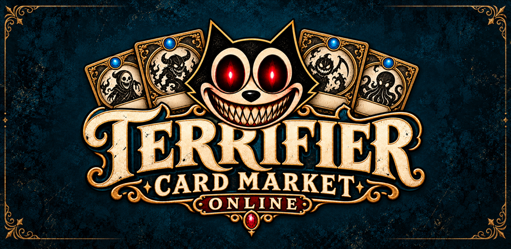
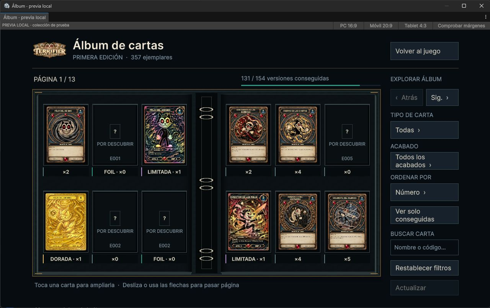
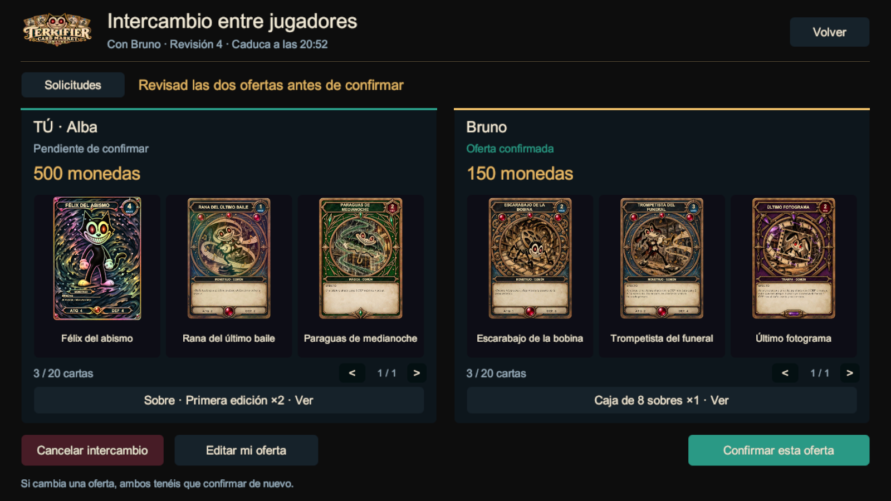
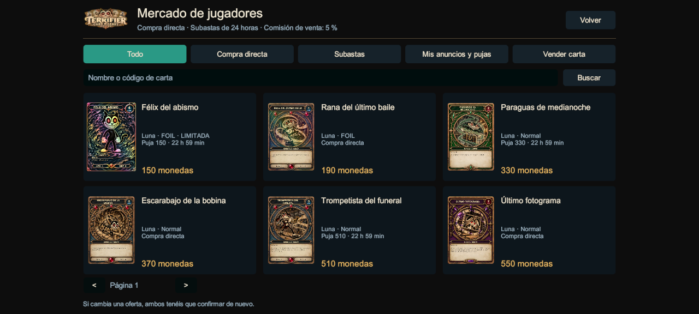

# Tu tienda. Tu colección. Un barrio online.

**Gestiona una tienda de cartas con criaturas de dibujos animados de terror.** Pide cajas, repón estanterías, pon tus precios y atiende a los clientes. Después abre un sobre, descubre sus seis cartas y busca las que te faltan intercambiando con otros jugadores.

**Gratis · Windows · En desarrollo · Requiere Internet**

### [Jugar en Windows — descargar ZIP](https://github.com/gorak182/terrifier-card-market-downloads/releases/latest/download/TerrifierCardMarket-Windows.zip)

[Ver la versión publicada y sus novedades](https://github.com/gorak182/terrifier-card-market-downloads/releases/latest) · [Prueba cerrada de Android](https://play.google.com/apps/testing/com.noxgamestudio.terrifiercardmarket) · [Material para creadores](PRESS-KIT.md)

## Qué puedes hacer

- **Llevar tu negocio:** pedidos desde el PC, mercancía, precios, caja registradora, licencias, muebles y ampliaciones.
- **Abrir y coleccionar:** sobres de seis cartas, álbum y 196 diseños, con versiones foil, full art y ediciones limitadas.
- **Jugar con otras personas:** visitas a tiendas, intercambios de cartas y monedas, amigos, chat y duelos con tu mazo.
- **Comprar y vender cartas:** mercado de jugadores con compra directa y subastas; se usan monedas del juego.

Las criaturas gastan maná. Las magias y trampas cuestan vida. No todo consiste en encontrar una carta bonita: también puedes construir tu mazo para jugarla.

## Así se ve la colección

*Álbum mostrado en el Editor con una colección de prueba. Las cartas de la imagen no son un regalo inicial.*

*Interfaz del juego con dos participantes simulados para mostrar las dos ofertas.*

*Vista del mercado con anuncios de prueba; no representa anuncios ni precios actuales de jugadores.*

## Empieza a jugar

1. Pulsa **Jugar en Windows** y descarga `TerrifierCardMarket-Windows.zip`.
2. Extrae **toda la carpeta** del ZIP.
3. Abre **TerrifierCardMarket.exe**, inicia sesión y entra en tu tienda.

También puedes ir a [la página de versiones](https://github.com/gorak182/terrifier-card-market-downloads/releases/latest): el archivo correcto está en **Assets** y se llama **TerrifierCardMarket-Windows.zip**. Los archivos «Source code» no contienen el juego.

Para actualizar, extrae la nueva versión en otra carpeta y usa tu cuenta habitual. El progreso se guarda en el servidor. El primer acceso puede tardar mientras arranca el servidor.

## Android y juego entre plataformas

Windows y Android comparten el mismo juego online. Android se distribuye mediante una **prueba cerrada**: necesitas acceso como tester y aceptar la prueba con esa misma cuenta de Google. El enlace no concede acceso por sí solo.

[Acceder a la prueba de Google Play](https://play.google.com/apps/testing/com.noxgamestudio.terrifiercardmarket)

## Estamos buscando jugadores que lo prueben

Terrifier todavía está en desarrollo. Habrá fallos y ajustes de equilibrio; nos sirve mucho saber qué funciona, qué se hace pesado y dónde te atascas.

Puedes [dejar un comentario o comunicar un fallo](https://github.com/gorak182/terrifier-card-market-downloads/issues/new) indicando la versión, qué estabas haciendo y si juegas en Windows o Android. Soporte: **gorkaokami@gmail.com**.

Si te gusta, comparte esta página con un amigo:

**https://github.com/gorak182/terrifier-card-market-downloads**

---

Este repositorio contiene la distribución pública y material del juego. No contiene el proyecto Unity ni el código del servidor. Cada versión incluye `SHA256SUMS.txt` para comprobar la integridad de la descarga. El juego y sus recursos conservan sus derechos y licencias; las licencias de terceros acompañan a la aplicación. Las monedas y los artículos son virtuales, sin valor en dinero real.
